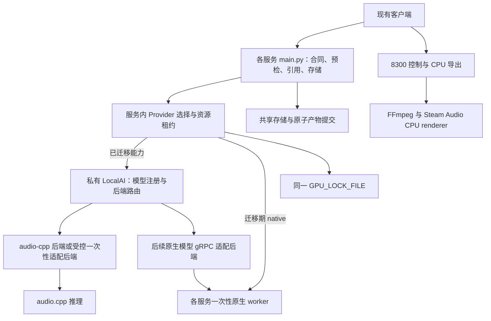

# LocalAI 与 audio.cpp 分阶段升级方案

> 状态：实施设计，尚未接入运行代码。编写日期：2026-10-20。
> 仓库核对基线：`26d03f28184598ba6fe906843347794d8fc1832f`。
> 读者：后续执行升级的开发者、编码模型与验收人员。
> 本文中的新增目录、配置、状态字段和测试文件均为**拟新增**；不能据此声称已实现。

## 1. 目标与讨论结论

目标是让 LocalAI 统一管理推理模型与后端，并逐步把现有音频模型的推理实现迁移到
audio.cpp。现有业务 API、音色引用、产物存储、CPU 空间渲染继续承担产品职责。
迁移以“服务中的具体能力”为单位，最终减少重复的 Python 模型依赖与生命周期代码。

已阅读用户提供的[分享讨论](https://chatgpt.com/share/6ad70c06-e030-83ec-a68f-56c3719f3fbf)。
网页浏览器抓取失败后，通过分享页公开 HTML 中的序列化对话读取正文。讨论包含音乐模型对比、
量化与显存、分轨制作，以及 LocalAI、llama-swap 等平台选择；本文不复制整份对话。

采用的上下文：

- 讨论中的目标机器为 RTX 4070 Ti Super 16 GB、48 GB RAM、WSL2 Ubuntu；这是规划假设，
  P0 必须读取实际设备信息确认。其他 GPU 的显存/速度报告不能当成本机验收结果。
- 用户已选择 LocalAI，本文不引入 llama-swap、Xinference 等第二套模型调度平台。
- 音乐、对白、分离、空间渲染按独立步骤执行；保留对象和音轨，不把后处理宣称为模型原生能力。
- HeartMuLa、MiniMax 等讨论中的新增模型仅列为后续扩展，不成为迁移现有服务的前置依赖。
- “统一协调”指模型注册、后端选择、执行生命周期和可观测性。创作业务流程仍由确定性业务代码
  组合，不要求 LLM Agent 自主决定调用哪个模型，不把现有原生接口改成多模型流水线。

### 1.1 完成标准

本次交付是升级文档，不执行安装、下载权重或迁移运行代码。未来实施完成应满足：

1. 迁移范围内的推理经 LocalAI 调用，audio.cpp 支持且通过验证的能力使用 audio.cpp。
2. 现有客户端合同、存储语义、错误边界与资源互斥通过回归；每项转换有精确版本和证据。
3. 不支持的能力有明确的原生后端接入方式、待办和原因，不以“统一”之名删除功能。
4. 每个服务可独立切回原生 worker；移除旧依赖发生在验收及回滚观察窗口之后。
5. 真实模型质量、冷启动、内存、显存、异常退出都通过本机验证；mock 测试不能代替这些证据。

## 2. 已核实事实与待验证事项

| 结论 | 证据 | 对方案的影响 |
| --- | --- | --- |
| 现有 27 个服务 uv 项目，启动 30 个 HTTP 进程 | [start.sh](../start.sh)、[README](../README.md)、各服务 main.py | 按服务接入，不能一开始合并 Python 环境 |
| 主进程与 worker 分离，GPU 用共享文件锁 | [ASR main.py](../Qwen3_ASR_1.7B/main.py)、[共享 GPU 实现](../unitale_runtime/src/unitale_runtime/gpu.py) | 迁移必须覆盖启动、退出与锁作用域 |
| LocalAI 已提供 `audio-cpp` 后端，需显式指定 | [LocalAI audio.cpp 文档](https://localai.io/docs/features/audio-cpp/) | 优先评估现有后端，避免默认另建 HTTP 直连 |
| Qwen3 ASR/TTS 是不同 family；GGUF 格式不能跨引擎想当然复用 | [audio.cpp Qwen3 文档](https://github.com/0xShug0/audio.cpp/blob/main/docs/models/qwen3.md) | 分开注册；核对主模型、tokenizer、音频组件和转换版本 |
| LocalAI 支持外部 gRPC 后端接入 | [LocalAI advanced](https://localai.io/docs/advanced/) | 原生后端缺字段时可扩展协议/后端适配 |

当前没有本仓库上的 LocalAI/audio.cpp 实测报告。上游公开页面可能领先或落后于安装版本。
P0 必须固定 LocalAI commit/tag、后端镜像 digest、其内嵌 audio.cpp commit、权重 revision
及 SHA-256。不得使用网站首页版本号、`latest` 或某个 GGUF 文件名替代版本锁定。

必须区分四级证据：E0=候选；E1=固定版本上游代码声明；E2=LocalAI 完整传参与产物通过；
E3=本机质量、资源、异常场景通过。本文所有服务的迁移状态初始为 E0，不能直接标记生产可用。

## 3. 架构与职责



### 3.1 明确的边界

| 组件 | 职责 | 约束 |
| --- | --- | --- |
| 各服务 `main.py` | 请求校验、CPU 预检、引用解析、调用 provider、组装原有响应 | 不加载模型；维持现有端口与路由 |
| `main/main.py` | 健康/控制、上传检查、MiMo 代理、CPU 导出 | 不增加集中式模型路由，不恢复旧 `api/` |
| 服务 provider | 原生和 LocalAI 的类型化转换、超时、生命周期收尾 | 运行前确定路径，不能漏传字段 |
| LocalAI | 模型目录、模型到后端映射、后端启动与停止、推理分发 | 私有监听；所有生产推理经过资源租约 |
| audio.cpp | 已验证模型的实际推理 | 使用固定版本模型包；不能仅因扩展名相同复用权重 |
| 原生适配后端 | LocalAI 到现有一次性 Python/llama worker 的桥接 | 保留各 uv 环境和原生 I/O |
| `unitale_runtime` | 文件引用、存储、轻量租约与指标 | 不导入 FastAPI、Torch、模型包；不得增加 HTTP SDK 依赖 |

迁移期保留多个 HTTP 入口是合同兼容措施。完成后的**统一推理入口**是 LocalAI，
业务端口数量是否减少属于后续独立 API 版本迁移，不作为本次成功条件。
MiMo 云端、Steam Audio CPU 后处理无需为了形式统一而通过 audio.cpp。

### 3.2 推荐的新增代码布局

```text
inference_gateway/                 拟新增：轻量内部 Python 包，非集中式 HTTP API
  providers/                       native / localai provider 协议及转换
  localai_client.py                有界网络调用、错误分类、内部鉴权
  lifecycle.py                     请求退出确认、取消、异常隔离
  capabilities.py                  能力与字段映射检查
  pyproject.toml                   依赖轻量；作为 editable 包使用
localai/
  models/                          经验证的模型 YAML 模板
  backends/                        仅存自有适配代码，不提交第三方源码
  manifests/                       版本、权重 hash、能力与发布清单
scripts/localai/                    安装预检、启动、停止、真实 smoke 工具
reports/localai/                    仅提交脱敏的验收摘要和指标
```

新增包是否独立建 uv 项目由 P1 决定并记录；如果作为 editable 共享包，不另建无用锁文件。
引用它的服务更新依赖及各自 `uv.lock`。实际权重、下载缓存、临时音频、生成结果放在仓库外或
已忽略的运行目录，报告不嵌入上传内容、密钥或机器专用路径。

## 4. 单卡资源与生命周期方案

### 4.1 先保持一次性模型进程语义

本仓库要求每次请求后模型/CUDA 上下文退出。LocalAI 的空闲回收时间和“最多一个活动模型”
不自动满足该要求。P1 优先验证原生 audio-cpp 后端是否能按请求完成后确定性停止并确认退出。

若不能，使用 **LocalAI 外部 gRPC 适配后端 + 一次性 audio.cpp CLI 子进程**：
适配进程可以常驻但不加载模型，每次 RPC 启动一个引擎进程，结果完成后终止整个进程组。
CLI 只能由 LocalAI 后端调用，业务服务不得把绕过 LocalAI 的 CLI 路径标为迁移完成。
对于 CLI 无法完整输出的结构化能力，扩展自有后端或使用原生 provider，不能从日志猜测结果。

LocalAI 原生后端与该适配后端是两种实施选项，不同时负责一个请求。P1 形成决策记录，
列出选定方案、停止方法、PID/进程组归属、取消机制和验证证据，再进入 P2。
不得直接删除 AGENTS 的一次性规则来适配默认常驻行为。若未来确需热模型缓存，另写架构决策，
同步资源模型与仓库规则后再实施，不混入此次迁移。

### 4.2 锁归属和死锁预防

第一阶段沿用服务入口持有 `GPU_LOCK_FILE`，覆盖**LocalAI 加载到模型退出并等待释放**的全过程。
LocalAI 后端不再次获取同一锁；迁移期的旧 worker 路径仍由原有服务持锁。
P7 的原生 gRPC 桥接直接调用 worker，不能回调一个会重复获取锁的服务 HTTP 路由。

- 所有服务与容器指向同一个锁文件 inode；相同字符串但不同容器文件系统不算共享锁。
- LocalAI 只绑定本机私有地址；管理/推理接口通过权限隔离，关闭自动预加载与非受控推理入口。
  WebUI 的试运行也会抢 GPU，测试时必须由同一受控入口获取租约。
- 默认排队 900 秒，新增配置拒绝非正值；CPU 解码、格式检查、缺权重检查在排队前完成。
- LocalAI 内部排队也必须有界。外层互斥成功后不应再形成长队；不能依赖内部队列代替文件锁。
- `CUDA_RELEASE_DELAY` 保留在持锁范围内。锁只在模型进程退出确认后释放。
- 请求等待、连接、推理、清理分别设置超时。总上限覆盖这些阶段，不把 900 秒 GPU 排队
  算作短网络读超时；超过总期限立即进入取消及清理。

建议状态机：

```text
RECEIVED → VALIDATED → WAITING_GPU → STARTING → RUNNING
         → COLLECTING → STOPPING → RELEASE_WAIT → COMMITTING → SUCCEEDED
任意执行阶段异常 → CANCELLING → STOPPING → RELEASE_WAIT → FAILED
退出无法确认 → QUARANTINED（暂停新的 GPU 准入，清理后人工或自动复核恢复）
```

对已收到文件的成功请求，先复制到本请求 staging，再停止 backend；不能让停止删除尚未读取的结果。
释放 GPU 后可以做 CPU 编码与原子提交。响应发出前完成结果验证；文件响应的临时文件应在响应完成后清理。

HTTP 客户端超时不表示服务器停止推理。断连、SIGTERM、LocalAI 崩溃、服务进程被杀均需测试。
使用进程组和守护回收机制防止父进程退出后 GPU 子进程成为孤儿。仅依赖 `finally` 不覆盖 SIGKILL。
旧进程没有确认退出时，不自动重试、切换 native 或释放后继续接单。
若持锁进程被强杀，文件锁会自动释放，下一准入点必须检查遗留进程/隔离状态并完成恢复。

## 5. 合同适配与能力声明

### 5.1 Provider 协议

以下为设计协议，不是现有函数：

```python
class InferenceProvider:
    def capabilities(self) -> CapabilitySet: ...
    def validate(self, request: InferenceRequest) -> ExecutionPlan: ...
    def execute(self, plan: ExecutionPlan, context: RequestContext) -> InferenceResult: ...
    def cancel_and_reap(self, context: RequestContext) -> CleanupResult: ...
```

`ExecutionPlan` 固定 logical_model、task、provider、版本、设备、参数映射和输出类型；
`RequestContext` 包含 request_id、deadline、受控工作目录和资源租约。
`InferenceResult` 返回结构化文本/文件描述、采样率、声道、指标；不把服务器任意路径暴露给客户端。
`cancel_and_reap` 必须幂等，同时用于成功收尾和失败回收。

**迁移路径选择在获取 GPU 锁之前完成**：

- `native`：现有实现，初始默认。
- `localai`：强制已验证的能力；不支持的字段明确失败，不静默忽略。
- `auto`：后期可选，仅依据离线能力表在执行前选择；一旦开始推理不跨 provider 自动重试。

这些是拟新增配置值，不能覆盖请求体中已有的 `backend` 字段。
例如 Qwen 克隆现有 `backend="qwen3-tts"` 是旧合同的一部分，不能改作 provider 选择器。

### 5.2 具体接口适配示例

ASR 当前接口是 `POST :8371/v1/qwen3/asr`，multipart 字段为 `audio`、`language`、
`context`、`max_new_tokens`。成功 JSON 保留 `code`、`text`、`language`、`elapsed_seconds`
和 `audio.sha256/size_bytes/suffix`。依据 [当前实现](../Qwen3_ASR_1.7B/main.py)。

| 当前语义 | LocalAI 转换设计 | 必须验证 |
| --- | --- | --- |
| multipart `audio` | transcription 上传字段 `file` | 流式传输和大小上限，不整文件读内存 |
| `language` 可缺省 | 对应转写语言参数 | 自动识别结果真实返回；禁止填请求值冒充识别 |
| `context` | 专用上下文字段或自有后端参数 | 不盲目映射到 `prompt`；后端可能把 prompt 用于对齐 |
| `max_new_tokens` | 固定版本支持的请求选项 | 若未透传则该请求不得迁移 |
| 上传摘要 | 由原业务层计算 | 不信任后端重写 hash |
| `elapsed_seconds` | 明确保留旧语义并测试 | 排队时间单列，不混入模型计时 |

Qwen 克隆需额外处理：`audio_path` 是逻辑引用，解析及校验后复制/映射到受控任务目录；
`prompt_text`、`x_vector_only`、语言、采样、切段、停顿、去静音分别建立映射。
`device_map/dtype/attn_implementation` 等 PyTorch 专有字段不能直接伪造等价 C++ 参数；
非默认的此类请求由 native 接受，强制 localai 时给出明确不兼容错误。
VoiceDesign 与 Base 使用不同逻辑模型、配置和测试，不混用权重。

YuE2 当前合同有 `style/tags`、`lyrics`、`cot`、`abc`、`cfg_scale`、`seed`、
`abc_sampling`、`semantic_sampling` 和输出 `id`。基础歌词生成成功不代表 ABC 或双阶段采样迁移完成。
按字段逐个验证，全部支持前不能把整个 8314 服务标为已迁移。

### 5.3 错误、输出与存储

现有错误码先通过合同快照固化。新增内部错误统一分类，再由各服务映射回其当前 HTTP 语义；
不要批量把现有 500 改成 502/504。建议新内部分类为 INVALID_INPUT、UNSUPPORTED_CAPABILITY、
UNAVAILABLE、QUEUE_TIMEOUT、EXECUTION_TIMEOUT、BACKEND_FAILURE、INVALID_ARTIFACT。

- 原有 422 校验、上传错误码、缺依赖/权重及 GPU 排队 503 保留。
- 健康检查不执行推理；新增 provider、版本、缺文件、能力和最近失败字段，避免用 HTTP 200 表示模型可用。
- WAV 校验头、采样率、声道、长度、有限数值和可解码性；空文件、损坏文件不得原子提交。
- TIGER 保留三路指定名称及批次 ZIP；不能用人声/伴奏两轨替换对白/音效/音乐三轨。
- 参考音色仍走 `AudioReferenceStore`，不复制到 clone 形成重复 WAV；sidecar 和 hash 仍原子更新。
- 临时文件用 request_id 隔离，结果路径必须限制在任务目录内；拒绝路径穿越、外部 URL、越界符号链接。
- LocalAI 返回文件引用时，验证固定版本的下载/读取契约及实际存在性；不能把响应头中的文件名
  当作任意服务器文件读取授权。跨容器共享任务卷时保持两端可见路径映射。
- VAE latent、MERT NPZ、SheetSage ZIP、视频继续使用各自协议和保留策略；不归入 WAV 自动清理。

## 6. 全服务迁移矩阵

此表是执行分组，不是上游支持承诺。每行都必须补 E1→E3 证据；“候选”表示需要验证精确变体。
family 名称由固定版本 metadata/帮助信息读取，不能把服务目录名直接当 family。

| 现有项目 / 端口 | 批次 | 必须保留的能力或阻碍 |
| --- | --- | --- |
| `Qwen3_ASR_1.7B` / 8371 | P2 首个试点 | 自动语种、context、token 预算、长音频；量化后语种识别单测 |
| `qwen3_tts` / 8321 | P3 | Base 克隆、参考转写、x-vector、切段及采样 |
| `qwen3_voiceDesign` / 8301 | P3 | VoiceDesign 权重与描述，不误用 CustomVoice |
| `voxcpm2` / 8322 | P3 | clone/controllable、control_instruction 互斥与标签限制 |
| `moss_voiceGenerator` / 8302 | P3 | VoiceGenerator 专用设计能力，不替换成旧 MOSS 克隆 |
| `firered_tts3` / 8304、8325 | P3 | Instruct/Base 两模式，设计/克隆及当前已接入输出字段 |
| `LongCat_AudioDiT_3.5B_bf16` / 8323 | P3 | 准确参考转写、扩散参数 |
| `dots_tts_soar` / 8324 | P3 | 跨语言克隆、参考约束 |
| `Confucius4_TTS` / 8361 | P3 | 默认 zh、无需参考转写、原生时长行为 |
| `moss_soundEffect` / 8312 | P4 | 精确 v2.0，时长和声效语义 |
| `ace_step_1_5` / 8313 | P4 | 当前 XL Turbo 变体、歌词/器乐及当前已实现编辑模式 |
| `stable_audio_3_medium` / 8311 | P4 | Medium 精确型号，生成/补全/续写；不能用 Open/Small 替代 |
| `YuE2-3B` / 8314 | P4 | 完整多组件包、歌词/ABC/cot/分阶段采样 |
| `Step_Audio_EditX` / 8331 | P5 | 迭代编辑、情绪/风格/副语言，不能降为普通 TTS |
| `moss_audio_4b_thinking` / 8341、8342 | P5 | Thinking/Instruct 理解与推理输出；ASR 不等于理解 |
| `TIGER-DnR` / 8351 | P5 | 原模型与三类 Stem；其他分离模型不能作为透明替换 |
| `seed-vc` / 8381 | P5 | 语音 VC 与 F0 歌声 SVC 分开验证 |
| `Index-Echo-S2ST-9B-GGUF` / 8382 | P5/P7 | 完整 DubbingBridgeModel 原生包；禁止 ASR→翻译→TTS 替换 |
| `SheetSage2` / 8315 | P6/P7 | 乐谱/MIDI/标注 ZIP 与固定 revision 父模型 |
| `YuE2-Vae` / 8316 | P6/P7 | 独立 encode/decode、`[T,64]`、FP32 与分块解码 |
| `MERT-v2-FullSong` / 8317 | P6/P7 | 整曲/逐帧表征、30–360 秒、24 kHz；不是 speaker embedding |
| `Index-Homura-9B-GGUF` / 8383 | P7 原生桥接 | 文本 llama.cpp；音节/术语约束，非 audio.cpp |
| `Index-Nailong-9B-GGUF` / 8384 | P7 原生桥接 | NativeLong 固定模板/贪心，不丢长文预算 |
| `Index-Translate-9B-GGUF` / 8385 | P7 原生桥接 | 文本/图片与 mmproj、硬软约束，text/plain |
| `SoulX-FlashHead-1_3B` / 8391 | P7 原生桥接 | Lite/Pro、图像引用、带声音 MP4，离线单卡 |
| `ditto` / 8392 | P7 原生桥接 | 原生依赖、图像引用、带声音 MP4，离线单卡 |
| `mimo_tts` / 8303 | 保留云服务 | API key 环境读取；不迁移 audio.cpp |
| `main` / 8300、`steam_audio_renderer` | 保留 CPU | 空间对象 Manifest v1、重复 assets、standard 与空间路径边界 |

LocalAI 的 audio-cpp 接口涵盖 speech、transcriptions、sound-generation 与 audio transform；
但独立 codec encode/decode、音频理解与表征不应套入这些接口。当前文档明确列出部分 RPC 未实现，
所以 P6 应优先调查结构化扩展或原生桥接，而不是假定 YuE2 歌曲可生成就能提供独立 VAE。
参见 [audio-cpp 能力边界](https://localai.io/docs/features/audio-cpp/)。

## 7. 分阶段执行手册

每一阶段单独提交/PR；P3–P6 再按“一个模型的一项能力”拆分。先写合同测试，再实现适配，
最后真实 smoke 与放量。没有模型或设备时可以完成代码与 mock，但阶段状态必须停在
`implemented_unverified`，不得进入默认切换或删除依赖。

### P0：冻结基线与版本（不改默认运行行为）

输入：本文、AGENTS、README、当前源码。执行：

1. 记录 git HEAD/工作区改动；枚举所有路由、请求模型、默认值、响应类型、产物路径与错误码。
2. 将每行迁移矩阵展开成字段映射清单，登记源 main.py/worker.py 与测试位置。
3. 实际检查 OS/WSL、GPU 型号/驱动/VRAM、可用 RAM、磁盘、FFmpeg、uv、外部模型目录。
4. 固定 LocalAI/audio-cpp 版本组合；记录包内 audio.cpp revision，核对模型格式与组件清单。
5. 准备脱敏或授权的短、中、长样本，分别运行现有模型基线；无法运行的服务注明原因。

交付：`localai/manifests/versions.json`、`capabilities.json`、`reports/localai/baseline.md`。
验收：每个服务均有去向和缺口；版本值不能为 TODO/latest；现有质量门禁结果被记录。
回滚：删除新增报告/模板即可；无运行配置改变。

### P1：搭建隔离 LocalAI 与受控执行边界

依赖：P0。执行：

1. 独立启动私有 LocalAI（建议规划 8400，实际先检查占用），安装固定 audio-cpp 后端；
   模型下载仅安装期进行，请求期断网也应能工作。
2. 使用假后端测试注册、请求、超时和失败；实现轻量 client/provider 协议与配置校验。
3. 验证原生后端能否满足第 4 节退出要求；不满足则实现一次性外部 gRPC 适配后端。
4. 实现统一租约、隔离状态和孤儿回收；禁止绕过租约的 LocalAI GPU 调用。
5. `start.sh` 增加显式接入配置和依赖预检；初始关闭，不静默改变已有推理默认值。
   统一启动后的失败终止规则、进程组停止、端口检测同时补回归。

交付：轻量接入包、LocalAI 模板、自有后端（如需要）、启动/停止脚本、生命周期决策记录。
验收：原服务默认 native；无权重可跑 mock；成功/失败/超时/断连/父进程死亡均能清理；
单卡互斥实测必须在 P2 默认切换前完成。回滚：关闭新增开关、停止整个 LocalAI 后端组。

### P2：Qwen3-ASR 首个端到端试点

依赖：P1。修改 `Qwen3_ASR_1.7B/main.py` 的 provider 调用与可用性检查，保留 worker。
特别把当前 `build_worker_payload` 中原生 qwen-asr 依赖检查拆成 provider 特定检查，
避免已用 LocalAI 仍要求安装 PyTorch 推理包。改动覆盖
`tests/test_qwen3_asr_migration.py`，新增 client/租约/错误转换测试。

逐项验证第 5.2 节字段；如果 context/token 预算在标准接口中不可传递，补后端扩展再切换，
或仅把字段受支持的请求列入显式试验，不标整服务完成。先测试原精度，再测试 Q8。

交付：ASR 模型模板、字段映射、基线对照、故障注入与进程/显存报告。
验收：原 API 合同通过；自动语言识别和上下文样例通过；混合 native/LocalAI 并发互斥；
请求后无模型进程/CUDA 上下文遗留。回滚：设置该服务 provider=native 并重启，重放固定样本。

### P3：语音合成与音色设计

依赖：P2。顺序建议：Qwen Base → Qwen VoiceDesign → VoxCPM2 → 其他表内 TTS。
每个模式单独模型 ID；把 clone/vdes 任务与参考音频/文本绑定，不能依赖模糊自动判断。
逐项迁移采样、切段、停顿、设计音色同步引用、文本 sidecar、输出保留。

交付：每模型一个字段矩阵和 E3 报告，参考音色上传→设计→跨服务引用→克隆的回归链。
验收：原先拒绝的 style_prompt 仍拒绝；Vox 可控模式互斥不变；参考转写要求不变；
相同音色不新增 clone WAV；盲听和文本准确率达到第 9 节标准。
回滚：按模型/模式切回 native，不删除音色库或映射。

### P4：音效与音乐生成

依赖：P2，可与已独立验收的 P3 顺序推进，不并发占 GPU。建议 MOSS 声效 → ACE-Step →
Stable Audio Medium → YuE2；实际顺序可由 E1/E2 覆盖度调整，记录原因。

每个能力分别测试 text-to-audio、lyrics、edit/continue/inpaint、ABC、时长和采样控制。
禁止因只支持简单 prompt 就把歌词、初始音频、mask、BPM 或采样字段静默丢掉。
验证模型包全部组件和各自 dtype，比较生成阶段与解码阶段峰值。

交付：音乐参数映射、15/30/60 秒及业务目标长度报告、产物可解码检查、歌词与盲听记录。
验收：具体变体一致；当前实现的全部模式有清晰迁移状态；最长场景不过显存预算。
回滚：按能力回 native；保留已生成产物，不自动改其采样率/编码。

### P5：编辑、理解、分离、转换及 Echo

依赖：P2 和对应基础能力验收。逐个处理表中模型：

- 编辑：同输入多轮编辑，验证指令及目标内容；普通克隆结果不能算编辑通过。
- 理解：需要文本回答/时间语义与变体输出，不使用转写结果代替回答。
- 分离：同一次调用收集全部目标 Stem，核验名称、长度与同步，不重复推理三次。
- Seed-VC：语音与歌声分别配置和验证，保留 F0 与采样参数。
- Echo：只迁移完整原生 S2ST；验证源/目标语言、`return_info` ZIP 和临时清理。

交付：逐能力 RPC 缺口单；必要时自有 LocalAI 后端扩展；每项 E3 报告。
验收：输出语义与现有模型一致，无“近似模型替换”。回滚：该能力切回原生。
上游不足时进入 P7 原生桥接；继续保留 audio.cpp 移植待办，不因此阻塞其他已可迁移模型。

### P6：结构化音乐任务

依赖：P4 的多组件验证经验。评估 SheetSage2、YuE2-Vae、MERT 的精确能力。
检查 audio.cpp 是否暴露所需推理任务，再检查 LocalAI RPC；两个环节均无则登记待移植，
通过 P7 原生后端纳入协调。若扩展协议，附 schema/version、客户端兼容和上下游测试。

验收：VAE `[T,64]` 与 FP32 分块行为；MERT 1024 维/25 Hz、掩码平均语义；
SheetSage 固定父模型 revision 和 ZIP 内容全部通过。不能用 TTS codec 或 speaker embedding 替代。
回滚：使用原 worker 与原输出目录。

### P7：统一协调剩余原生后端

依赖：P1，及各能力的差距结论。为暂不能迁移 audio.cpp 的音频模型、Index 文本和视频模型
实现 LocalAI 外部适配。优先复用其 worker 输入/输出协议和独立 uv 解释器。
自有后端仅转译和管理子进程，不在常驻进程导入 Torch。

标准 RPC 无法承载结构化输出时，先交付经过版本化的后端/协议扩展；未实现前仍标 native-only，
不能把模型挂在目录里就算“已统一协调”。不得回调会再次持锁的 HTTP 服务形成递归链路。

验收：所有计划纳入的本地推理有 LocalAI 调用证据；Index 三个文本服务保留模板/原生 TXT；
视频保留 MP4 和图片引用；MiMo/CPU 服务明确列为边界。锁、崩溃清理与观测覆盖所有后端。
回滚：保留旧服务 provider=native 和旧 uv 环境，分服务退出桥接。

### P8：默认切换、观察与依赖收敛

依赖：对应能力 E3，不要求等待所有上游模型移植完成。先离线重放，再按固定请求/显式测试
用户启用；单卡不做双路实时 shadow 推理。推荐 10%→50%→100% 的稳定 request_id 分桶，
每档至少 50 个有效请求及一次最长输入；没有线上流量则等量离线回放，并明确样本限制。

观察至少 7 天或 200 个有效请求（取较晚者），包括一次服务重启和一次异常恢复演练。
发现严重合同回归、OOM、锁失效、产物损坏或无法退出，立即停止该能力放量并回滚。

交付：默认配置变更、全量矩阵、剩余差距、运维手册、回滚演练记录。
完成后才移除无引用的模型依赖；每个 uv 项目单独更新锁并检查。8300 当前借用 qwen3_tts
环境，清理该环境前须验证控制面依赖，必要时单独建立轻量 main 环境并同步启动/门禁。
不要为减少项目数量而合并不兼容 Torch/CUDA 环境。

## 8. 配置、部署与版本清单

以下 `UNITALE_*` 均为**拟新增项目配置**，不是 LocalAI 原生参数；P1 实现解析与校验后才生效。

| 配置 | 初始建议 | 含义 |
| --- | --- | --- |
| `UNITALE_LOCALAI_ENABLED` | `false` | 启用内部平台接入 |
| `UNITALE_LOCALAI_BASE_URL` | `http://127.0.0.1:8400` | 私有服务地址，部署时校验 |
| `UNITALE_INFERENCE_PROVIDER` | `native` | 全局缺省，仅作为服务未指定时兜底 |
| `UNITALE_QWEN3_ASR_PROVIDER` | `native` | 试点服务覆盖，其他服务按相同模式登记 |
| `UNITALE_LOCALAI_CONNECT_TIMEOUT` | `5` 秒 | 连接超时；非推理总时限 |
| `UNITALE_LOCALAI_CLEANUP_TIMEOUT` | `30` 秒 | 停止等待预算，超时进入隔离 |
| `UNITALE_LOCALAI_API_KEY` | 无默认值 | 内部鉴权，环境读取、日志脱敏 |

推理超时优先沿用各服务现有 REQUEST_TIMEOUT，不能给所有模型统一很短的 timeout。
`GPU_LOCK_FILE`、`GPU_LOCK_WAIT_TIMEOUT`、`CUDA_RELEASE_DELAY` 沿用既有配置。
新增启动参数只负责部署与路由，不静默重设模型推理默认值。

最小模型配置形状如下，文件名是占位符，必须替换为 P0 核验的制品；这不是已通过的运行配置：

```yaml
name: unitale-qwen3-asr-1p7b-candidate
backend: audio-cpp
parameters:
  model: qwen3-asr-verified.gguf
options:
  - family:qwen3_asr
  - task:asr
  - backend:cuda
  - device:0
  - busy_timeout_ms:120000
```

上层 `backend` 是 LocalAI 后端，下层 option 是计算设备选择；精确可用值以固定版本为准。
这些配置字段与显式安装 `local-ai backends install audio-cpp` 来自
[LocalAI 后端文档](https://localai.io/docs/features/audio-cpp/)。生产安装脚本还必须固定下载来源与 digest，
不能仅运行该未固定版本的安装命令。

每个模型制品清单应包含：

```json
{
  "schema_version": 1,
  "logical_model": "unitale.qwen3-asr.1p7b",
  "status": "candidate",
  "provider": "localai",
  "task": "asr",
  "localai_commit": "REQUIRED",
  "backend_digest": "REQUIRED",
  "audiocpp_commit": "REQUIRED",
  "model_revision": "REQUIRED",
  "artifacts": [{"relative_path": "model.gguf", "sha256": "REQUIRED"}],
  "contract_revision": "REQUIRED",
  "verified_fields": [],
  "unsupported_fields": [],
  "evidence": [],
  "rollback_provider": "native"
}
```

这是 schema 设计示例，部署校验必须拒绝 REQUIRED、空证据的 production 状态、未知字段、
缺失文件、hash 不符、未允许任务或设备。清单同时记录模型/量化包许可来源与核验日期；
讨论中的商业用途判断不代替精确制品的许可核对。

容器部署时挂载只读模型卷、可写任务卷与同一个锁文件；默认不挂整个 home。
WSL 模型和任务优先放 Linux 文件系统，P0 测量磁盘吞吐；容器 GPU 设备映射、驱动与后端 CUDA
版本需要实际 smoke。部署离线模式时提前准备全部组件，缺文件直接报 unavailable，不请求时下载。

启动顺序：配置/端口/文件预检 → LocalAI 与轻量适配后端就绪 → 业务服务 → 综合健康。
停止顺序：停止准入 → 有界等待/取消在途请求 → 回收模型进程 → 业务服务/LocalAI 退出。
默认启用 LocalAI 的服务依赖失败时报告不可用；不能悄悄切换推理引擎掩盖部署故障。

## 9. 验证与发布门禁

### 9.1 无模型验证

现有质量门禁保持完整；新增 Python 包/脚本/项目需加入相应检查列表和 CI。
已有命令从仓库根目录执行：

```bash
bash -n start.sh
bash scripts/quality_gate.sh
uv run --project qa --locked python -m unittest discover -s tests -v
```

最后一条仅用于开发期定向重跑，完整门禁已包含根测试，无需每次重复执行。
ACE-Step、Stable Audio 服务内测试仍从各自目录使用 QA 执行。锁检查受网络/缓存影响时
记录真实原因；只在缓存完整时设置 `UV_OFFLINE=1`，不能把失败改写为通过。

新增测试最小集合：

| 测试面 | 核心断言 |
| --- | --- |
| 合同 | 每个字段、默认值、拒绝项、成功/失败响应与内容类型 |
| provider 路由 | native 默认、局部切换、能力不足显式失败、无推理后自动重试 |
| 上传与引用 | 超限、错误 MIME、路径穿越、sidecar 原子性、跨服务引用与去重 |
| 生命周期 | 成功/异常/超时/取消均 reap，先退出后解锁，父进程死亡恢复 |
| 并发 | 多服务共享一把锁，无重复获取，无等待无期限 |
| 制品 | 损坏/空/多文件不完整结果不提交，取消无残留 |
| 部署 | 开关关闭不影响旧启动；新端口检查、依赖缺失和全组停止 |
| 健康 | 无模型加载、可用性真实、最近错误和 provider 可追踪 |

建议测试文件：`tests/test_localai_client.py`、`test_inference_provider_contract.py`、
`test_localai_lifecycle.py`、`test_localai_config.py`，以及各服务现有 migration 测试。
这些是待新增文件，不能引用为当前通过证据。自动测试不下载权重、不调用真实 MiMo、不需要 CUDA。

### 9.2 真实模型与资源验证

每个模型至少选择 10 个有代表性样本，覆盖中文/英文/适用其他语言、短/长输入、特殊字段、
边界时长；每个性能样本重复 3 次。固定输入、参考音频、采样配置和种子，但不要求不同引擎逐字节同音。
先比较同精度实现，再比较量化，避免混淆引擎差异与量化损失。

记录模型加载、推理、解码、停止、排队、总耗时；RTF=推理秒数/输出音频秒数；同时记录
主机内存峰值、GPU 峰值、任务结束后的显存基线和进程树。现有采样是全可见 GPU 汇总，
不能把其数值误称为模型独占峰值；本机空闲基线和其他进程都要记录。

以下为**初始工程门槛**，P0 按业务样本冻结，调整必须记录依据，不能在失败后无说明放宽：

| 维度 | 初始门槛 |
| --- | --- |
| 合同与存储 | 全部回归通过；0 静默丢字段、0 错误产物提交 |
| ASR | 总体 CER/WER 相对基线增加不超过 1 个百分点；分语种检查，自动识别正确数不下降 |
| TTS | 固定评测器文字错误率增加不超过 1 个百分点；至少两人盲听平均自然度/相似度下降不超过 0.2/5 |
| 音乐/音效/编辑 | 两人盲听平均下降不超过 0.3/5，任务遵循与歌词错误单列；关键编辑样例不得失效 |
| 结构化任务 | schema/形状/时间轴/文件列表严格一致，数值容差按原模型任务定义冻结 |
| 资源 | 目标最大输入 0 OOM；16 GB 假设下建议峰值先控制在 13 GiB 内，实际基线后确定 |
| 生命周期 | 每次结束无所属模型 GPU 进程；30 秒内回到空闲基线 + 256 MiB 内，超出需调查 |
| 性能 | p95 总耗时不高于基线 1.2 倍；若显存显著改善可形成单独权衡决策 |
| 稳定性 | 100 次交替模型调用和至少 10 次各类故障注入，无泄漏/死锁/错误提交 |

10 个样本不能代表全部语言或长期质量，报告必须写覆盖范围。未组织盲听则质量门禁未完成。
若原生基线在目标硬件无法运行，使用可执行的较短基线并明确限制；较长场景记录绝对结果，
不能伪造相对性能。量化 ASR 的自动语种识别可能下降，上游也明确提醒这一点，见
[audio.cpp Qwen3 说明](https://github.com/0xShug0/audio.cpp/blob/main/docs/models/qwen3.md)。

必须执行混合路径场景：native TTS → LocalAI ASR → native 视频 → LocalAI 音乐；
同时提交两个 GPU 请求，确认不会并行加载；另发 CPU 空间导出，确认其不获取 GPU 锁。
逐一注入 backend crash、LocalAI crash、服务 SIGKILL、客户端断连、超时、磁盘满和结果损坏。

### 9.3 回滚操作顺序

1. 停止该能力的新请求，记录当前 request_id、provider 和版本。
2. 取消或等待在途任务，确认模型及其子进程退出；若未退出，保持隔离并修复，禁止立即启用 native。
3. 恢复该服务 provider=native 和已保存配置；使用原锁定环境重启受影响进程。
4. 健康检查依赖状态，执行一条原生真实 smoke，再恢复流量。
5. 保留失败日志、配置/制品哈希和已提交用户产物；仅清理当前任务临时文件。
6. 清单降级为 candidate/failed，登记原因和恢复条件；不要删去失败记录。

版本回滚同时恢复 LocalAI core、backend digest、audio.cpp revision 和模型包的已验证组合。
不能只回退 Python 代码而继续使用不兼容的新权重。

## 10. 后续模型的执行与交接约定

每次开始先读本文件、AGENTS、CONSTITUTION、README 和上次报告，然后检查当前源码及 git diff。
不要根据本方案中的未来路径推断文件已存在；不要把上次代理的总结替代实际验证。

可直接使用下列任务提示：

```text
依据 docs/localai-audiocpp-upgrade.md 执行阶段 P<编号> 的 <模型/能力>。
先核对前置阶段证据、当前源码、固定上游版本与字段映射。
只完成本阶段授权范围，保持原生回滚路径与仓库架构约束。
实现并运行相关无模型测试；有真实环境时完成指定 smoke 和资源验证。
缺真实环境时标记 implemented_unverified，报告缺口，不切默认、不删除原生依赖。
交付实际变更、执行命令及结果、失败/未测项、回滚步骤和下阶段准确入口。
```

每阶段报告模板（拟保存为 `reports/localai/Px-model.md`）：

```markdown
# P<阶段>：<模型与能力> 验收记录
- 状态：planned / implementing / implemented_unverified / verified / rolled_back
- 仓库基线与变更提交：
- 前置报告与证据等级：
- LocalAI / backend digest / audio.cpp / 权重 revision 与 hash：
- 设备、驱动、操作系统、内存和空闲显存：
- 已迁移字段；未迁移字段及原因：
- 变更文件与当前默认 provider：
- 无模型验证命令、退出码、日期：
- 真实样本覆盖、质量、p50/p95、峰值显存、退出检查：
- 故障注入与回滚演练结果：
- 未解决事项、下一步及停止条件：
```

完成一个阶段必须逐条核对：

- [ ] 前置阶段真实状态允许推进，版本/权重与报告一致。
- [ ] 请求字段和输出逐项映射，无不支持能力被标成已实现。
- [ ] 单次模型进程、GPU 锁、超时、退出、隔离与文件清理均有验证。
- [ ] 相应测试和完整发布门禁有实际结果；真实模型质量未用 mock 替代。
- [ ] README、配置说明、门禁和 AGENTS 中受影响的现状说明同步。
- [ ] 默认切换符合发布门槛，回滚配置和原生环境仍可用。
- [ ] 上游能力差距保留待办；没有用其他模型/多模型流程偷偷替换原能力。

## 11. 来源与适用性

本方案的架构、阶段、阈值和配置设计是针对当前仓库提出的工程决策；不是上游提供的部署承诺。
外部事实核对日期为 2026-10-20，实施时必须将动态分支链接替换/补充为选定 commit 的永久链接。

- [原始分享讨论](https://chatgpt.com/share/6ad70c06-e030-83ec-a68f-56c3719f3fbf)：需求背景与设备假设。
- [LocalAI audio.cpp](https://localai.io/docs/features/audio-cpp/)：后端配置、任务路由及未实现 RPC。
- [LocalAI 外部后端](https://localai.io/docs/advanced/)：自有 gRPC 后端接入机制。
- [LocalAI 模型配置](https://localai.io/docs/advanced/model-configuration/)：模型 YAML 与配置边界。
- [audio.cpp 项目](https://github.com/0xShug0/audio.cpp)：引擎与模型 family 入口。
- [audio.cpp Qwen3](https://github.com/0xShug0/audio.cpp/blob/main/docs/models/qwen3.md)：模型组件、GGUF 和量化注意点。
- [工程规范](python-engineering.md)、[仓库指南](../AGENTS.md)、[宪章](../CONSTITUTION.md)：本地实施边界。

**下一项可执行工作：P0。** 先固定版本与全服务合同/基线清单，再进行 LocalAI 隔离接入；
不要直接批量修改 27 个模型服务。
